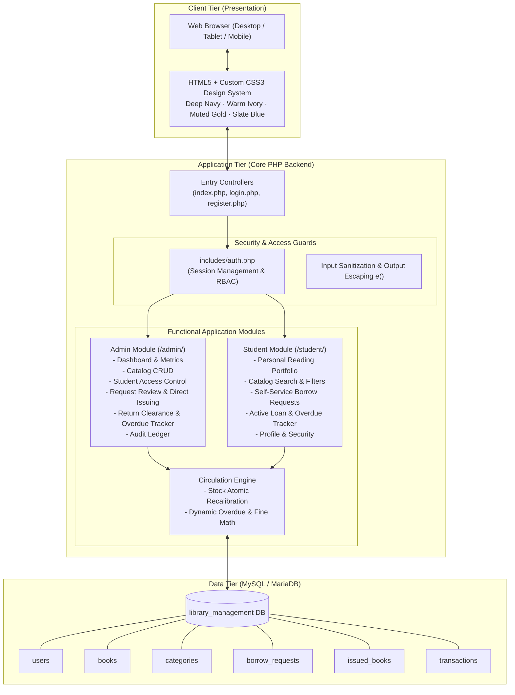
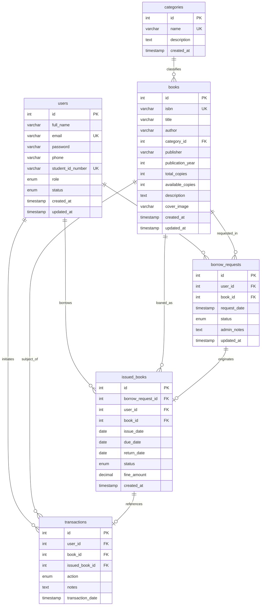
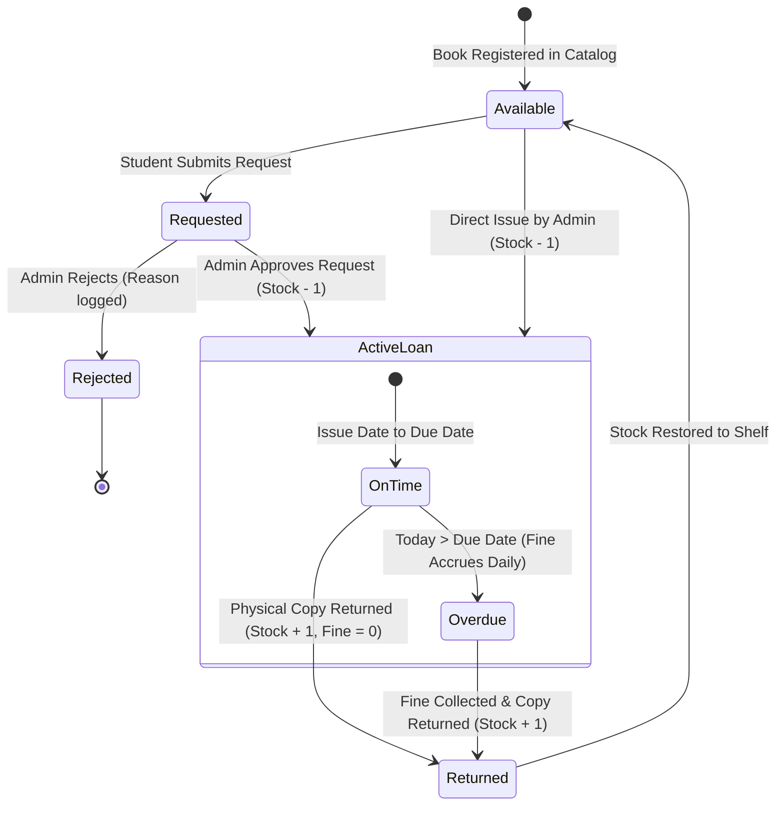

# THE ARCHIVE · IIIT KOTA DIGITAL LIBRARY
## System Architecture & Database Schema Specification

> **Project:** Library Management System  
> **Institution:** Indian Institute of Information Technology (IIIT) Kota  
> **Curriculum:** B.Tech Web Development Lab Evaluation & Viva Voce  
> **Core Stack:** HTML5 · CSS3 · Core PHP (Native) · MySQL (InnoDB) · XAMPP  

---

## 1. High-Level System Architecture

The application is structured following a **Modular Layered Architecture** inspired by the classic Model-View-Controller (MVC) paradigm, executed cleanly in native Core PHP without external framework dependencies.



### Architectural Layers Explained

1. **Presentation Layer (View):**
   - Built with semantic **HTML5** and an institutional **native CSS3** design system.
   - Strict palette: **Deep Navy (`#0f1b2d`)**, **Warm Ivory (`#FAF7F0`)**, **Muted Gold (`#c89b3c`)**, **Slate Blue (`#526075`)**, and border **`#E5E1D8`**.
   - Zero external CDNs or UI libraries; embedded vector SVGs ensure 100% offline uptime on localhost.

2. **Access Control & Session Layer (Middleware):**
   - Evaluated on every request via `includes/auth.php`.
   - Distinguishes between guest visitors, verified students, and administrators.
   - Prevents unauthorized privilege escalation through URL manipulation.

3. **Application & Controller Layer (Core PHP):**
   - Procedural controllers process form submissions, handle file uploads, validate business constraints, and coordinate data operations.
   - Concurrency protection: Multi-step circulation operations (e.g., approving a request and issuing a book) are wrapped in atomic database transactions.

4. **Data Persistence Layer (MySQL/InnoDB):**
   - Normalized relational database (`library_management`) configured with foreign key relationships, referential cascading, and UTF-8 multibyte character encoding (`utf8mb4`).

---

## 2. Complete Database Schema (Entity-Relationship Design)

The database schema is normalized up to **Third Normal Form (3NF)** to eliminate data redundancy while maintaining relational integrity.



---

## 3. Data Dictionary & Table Specifications

### 3.1 Table: `categories`
Stores academic departments and disciplines for book classification.

| Field | Data Type | Constraints | Description |
| :--- | :--- | :--- | :--- |
| `id` | `INT` | `AUTO_INCREMENT`, `PRIMARY KEY` | Unique category identifier |
| `name` | `VARCHAR(100)` | `NOT NULL`, `UNIQUE` | Discipline name (e.g. Computer Science, Mathematics) |
| `description` | `TEXT` | `NULL` | Departmental syllabus scope |
| `created_at` | `TIMESTAMP` | `DEFAULT CURRENT_TIMESTAMP` | Record creation timestamp |

---

### 3.2 Table: `users`
Stores student and administrator credentials and account state.

| Field | Data Type | Constraints | Description |
| :--- | :--- | :--- | :--- |
| `id` | `INT` | `AUTO_INCREMENT`, `PRIMARY KEY` | Unique user account ID |
| `full_name` | `VARCHAR(100)` | `NOT NULL` | User full name |
| `email` | `VARCHAR(100)` | `NOT NULL`, `UNIQUE` | College email address for authentication |
| `password` | `VARCHAR(255)` | `NOT NULL` | Secure Bcrypt cryptographic hash |
| `phone` | `VARCHAR(20)` | `NULL` | Contact phone number for reminders |
| `student_id_number` | `VARCHAR(50)` | `NULL` | Institutional Roll / ID (e.g., `CS2024001`) |
| `role` | `ENUM('admin', 'student')` | `NOT NULL`, `DEFAULT 'student'` | Access role for authorization |
| `status` | `ENUM('active', 'inactive')`| `NOT NULL`, `DEFAULT 'active'` | Administrative privilege suspension switch |
| `created_at` | `TIMESTAMP` | `DEFAULT CURRENT_TIMESTAMP` | Account registration date |
| `updated_at` | `TIMESTAMP` | `AUTO UPDATE CURRENT_TIMESTAMP` | Last profile modification date |

---

### 3.3 Table: `books`
Main inventory catalog containing physical stock numbers and metadata.

| Field | Data Type | Constraints | Description |
| :--- | :--- | :--- | :--- |
| `id` | `INT` | `AUTO_INCREMENT`, `PRIMARY KEY` | Unique book catalog ID |
| `isbn` | `VARCHAR(30)` | `NOT NULL`, `UNIQUE` | International Standard Book Number |
| `title` | `VARCHAR(255)` | `NOT NULL` | Book volume title |
| `author` | `VARCHAR(255)` | `NOT NULL` | Author(s) / Editor(s) |
| `category_id` | `INT` | `NOT NULL`, `FOREIGN KEY` | References `categories(id)` ON DELETE RESTRICT |
| `publisher` | `VARCHAR(255)` | `NULL` | Publishing house |
| `publication_year`| `INT` | `NULL` | Year of publication |
| `total_copies` | `INT` | `NOT NULL`, `DEFAULT 1` | Total physical copies owned |
| `available_copies`| `INT` | `NOT NULL`, `DEFAULT 1` | Copies currently on shelves |
| `description` | `TEXT` | `NULL` | Syllabus syllabus scope & synopsis |
| `cover_image` | `VARCHAR(255)` | `NULL` | File name in `assets/images/covers/` |
| `created_at` | `TIMESTAMP` | `DEFAULT CURRENT_TIMESTAMP` | Catalog entry timestamp |
| `updated_at` | `TIMESTAMP` | `AUTO UPDATE CURRENT_TIMESTAMP` | Inventory adjustment timestamp |

---

### 3.4 Table: `borrow_requests`
Queue of online reservation requests submitted by students.

| Field | Data Type | Constraints | Description |
| :--- | :--- | :--- | :--- |
| `id` | `INT` | `AUTO_INCREMENT`, `PRIMARY KEY` | Unique request tracking code |
| `user_id` | `INT` | `NOT NULL`, `FOREIGN KEY` | References `users(id)` ON DELETE CASCADE |
| `book_id` | `INT` | `NOT NULL`, `FOREIGN KEY` | References `books(id)` ON DELETE CASCADE |
| `request_date` | `TIMESTAMP` | `DEFAULT CURRENT_TIMESTAMP` | When student submitted the request |
| `status` | `ENUM('pending', 'approved', 'rejected')` | `DEFAULT 'pending'` | Workflow state of reservation |
| `admin_notes` | `TEXT` | `NULL` | Administrative feedback or rejection reason |
| `updated_at` | `TIMESTAMP` | `AUTO UPDATE CURRENT_TIMESTAMP` | Date of admin review |

---

### 3.5 Table: `issued_books`
Active circulation loans, scheduled deadlines, return records, and calculated fines.

| Field | Data Type | Constraints | Description |
| :--- | :--- | :--- | :--- |
| `id` | `INT` | `AUTO_INCREMENT`, `PRIMARY KEY` | Circulation loan ID |
| `borrow_request_id` | `INT` | `NULL`, `FOREIGN KEY` | References `borrow_requests(id)` ON DELETE SET NULL |
| `user_id` | `INT` | `NOT NULL`, `FOREIGN KEY` | References `users(id)` ON DELETE CASCADE |
| `book_id` | `INT` | `NOT NULL`, `FOREIGN KEY` | References `books(id)` ON DELETE CASCADE |
| `issue_date` | `DATE` | `NOT NULL` | Date book copy was released |
| `due_date` | `DATE` | `NOT NULL` | Scheduled deadline for return |
| `return_date` | `DATE` | `NULL` | Actual date physical copy was returned |
| `status` | `ENUM('issued', 'returned', 'overdue')` | `DEFAULT 'issued'` | Loan state |
| `fine_amount` | `DECIMAL(8,2)` | `NOT NULL`, `DEFAULT 0.00` | Overdue fee recorded upon return |
| `created_at` | `TIMESTAMP` | `DEFAULT CURRENT_TIMESTAMP` | Record creation timestamp |

---

### 3.6 Table: `transactions`
Permanent audit trail logging all circulation operations.

| Field | Data Type | Constraints | Description |
| :--- | :--- | :--- | :--- |
| `id` | `INT` | `AUTO_INCREMENT`, `PRIMARY KEY` | Audit entry identifier |
| `user_id` | `INT` | `NOT NULL`, `FOREIGN KEY` | References `users(id)` ON DELETE CASCADE |
| `book_id` | `INT` | `NOT NULL`, `FOREIGN KEY` | References `books(id)` ON DELETE CASCADE |
| `issued_book_id`| `INT` | `NULL`, `FOREIGN KEY` | References `issued_books(id)` ON DELETE SET NULL |
| `action` | `ENUM('borrow_request', 'request_approved', 'request_rejected', 'book_issued', 'book_returned')` | `NOT NULL` | Action code |
| `notes` | `TEXT` | `NULL` | Automated system commentary |
| `transaction_date`| `TIMESTAMP` | `DEFAULT CURRENT_TIMESTAMP` | Exact wall-clock timestamp of event |

---

## 4. Key Business Logic & Algorithms

### 4.1 Circulation Workflow State Machine



### 4.2 Overdue Detection and Fine Calculation

The daily overdue fine calculation is handled by the deterministic function `calculate_overdue_and_fine()` defined in `config/database.php`:

$$\text{Compare Date} = \begin{cases} \text{return\_date} & \text{if book is returned} \\ \text{today (CURDATE())} & \text{if book is currently on loan} \end{cases}$$

$$\text{Days Overdue} = \max\left(0, \; \text{Compare Date} - \text{due\_date}\right)$$

$$\text{Fine Amount} = \text{Days Overdue} \times \text{FINE\_PER\_DAY}$$

Where:
- $\text{FINE\_PER\_DAY} = \text{₹}5.00$
- $\text{LOAN\_PERIOD\_DAYS} = 14 \text{ days}$

### 4.3 Atomic Stock Synchronization Rules

1. **On Book Issue (`admin/borrow_requests.php` & `admin/issue_book.php`):**
   ```sql
   UPDATE books SET available_copies = available_copies - 1 
   WHERE id = ? AND available_copies > 0;
   ```
   *Guarantees available copies can never fall below 0.*

2. **On Book Return (`admin/return_book.php`):**
   ```sql
   UPDATE books SET available_copies = LEAST(total_copies, available_copies + 1) 
   WHERE id = ?;
   ```
   *Guarantees available copies can never exceed total copies.*

---

## 5. Security & Defensive Programming Architecture

| Threat / Vulnerability | Defense Mechanism | Implementation File |
| :--- | :--- | :--- |
| **SQL Injection (SQLi)** | 100% Parameterized Prepared Statements (`prepare`, `bind_param`, `execute`) | Across all modules (`config/database.php`) |
| **Cross-Site Scripting (XSS)** | Centralized output encoding helper `e($val)` wrapping `htmlspecialchars()` | `config/database.php`, `includes/header.php` |
| **Credential Theft** | Cryptographic one-way hashing with salt using `password_hash(..., PASSWORD_DEFAULT)` | `register.php`, `login.php`, `student/profile.php` |
| **Session Fixation** | Re-generating session identifier upon successful login via `session_regenerate_id(true)` | `includes/auth.php` |
| **Privilege Escalation** | Strict server-side route guards `require_admin()` and `require_student()` | `includes/auth.php` |
| **Malicious File Upload** | Extension whitelist validation (`jpg`, `jpeg`, `png`, `webp`, `svg`) & random filename hashing | `admin/add_book.php`, `admin/edit_book.php` |
