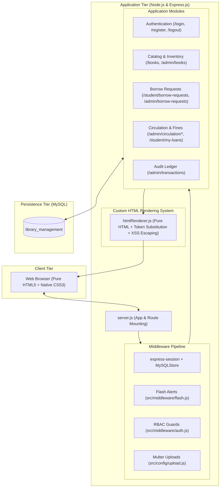

# The Archive | IIIT Kota Digital Library

> **Where Learning Goes Beyond Classrooms.**<br/>
> *Your gateway to knowledge, discovery, and academic excellence.*

A centralized, full-stack digital library management platform engineered to modernize how students discover, borrow, and manage academic resources at **Indian Institute of Information Technology (IIIT) Kota**.

The Archive addresses the bottlenecks of traditional, paper-based, or fragmented library operations by bringing catalog discovery, student accounts, borrowing requests, circulation management, overdue fine tracking, and transaction audit trails into a unified web application.

The application backend is built using **Node.js and Express.js** with **MySQL** for relational persistence and session storage. The presentation layer is implemented strictly in **pure semantic HTML5 and native CSS3** with **zero client-side JavaScript**, adhering to core web development standards, institutional branding, and server-side rendering principles.

---

## Table of Contents

- [1. Project Introduction](#1-project-introduction)
- [2. Project Overview](#2-project-overview)
- [3. Main Features](#3-main-features)
- [4. Technology Stack](#4-technology-stack)
- [5. Project Folder Structure](#5-project-folder-structure)
- [6. Prerequisites and Software Requirements](#6-prerequisites-and-software-requirements)
- [7. Installation Instructions](#7-installation-instructions)
- [8. Environment Variable Configuration](#8-environment-variable-configuration)
- [9. MySQL Database Setup](#9-mysql-database-setup)
- [10. How to Run the Project Locally](#10-how-to-run-the-project-locally)
- [11. Available npm Commands](#11-available-npm-commands)
- [12. Application Modules and Functionality](#12-application-modules-and-functionality)
- [13. Authentication and Security Features](#13-authentication-and-security-features)
- [14. Testing Instructions](#14-testing-instructions)
- [15. Team Contribution Information](#15-team-contribution-information)
- [16. Future Improvements](#16-future-improvements)

---

## 1. Project Introduction

Academic libraries require seamless coordination between students seeking coursework materials and administrators managing physical inventory. When catalog management, borrowing records, and return deadlines are handled manually, institutions face inventory discrepancies, lost books, unrecorded fines, and delayed request processing.

**The Archive** bridges this gap through a high-performance web application tailored for the academic community at IIIT Kota. It provides:

- **Self-service catalog discovery:** Students can browse, search, and review available copies online from any device.
- **Paperless borrowing workflows:** Students submit digital borrowing requests; administrators review, approve, or reject them with feedback.
- **Accurate circulation tracking:** Real-time visibility into who holds each book, return deadlines, overdue statuses, and calculated fines.
- **Institutional accountability:** A structured ledger records all critical circulation events.

---

## 2. Project Overview

The Archive operates on a strict **Role-Based Access Control (RBAC)** model separating administrative operations from student activities:

| User Role | Responsibilities | Access Scope |
|---|---|---|
| **Administrator** | Manages catalog inventory, student accounts, review of borrow requests, manual book issuing, return clearance, fine calculations, and audit logs. | Full access to `/admin/*` routes and administrative actions. |
| **Student** | Explores book collections, submits borrow requests, tracks active loans, monitors return due dates, reviews borrowing history, and manages personal profile details. | Access restricted to `/student/*` routes, public catalog, and self-profile. |

### Business Rules & Circulation Governance

The Archive enforces real-world library business constraints:

1. **Inventory Stock Protection:** A student cannot request a book if `available_copies <= 0`.
2. **Duplicate Request Prevention:** Students cannot submit multiple pending requests for the same title.
3. **Active Loan Guard:** Students cannot request a book they already currently hold on an active loan.
4. **Account Status Verification:** Deactivated or suspended student accounts are blocked from requesting or receiving books.
5. **Atomic Stock Updates:** Approving a request or issuing a book decrements `available_copies`; returning a book increments it up to `total_copies`.
6. **Automatic Overdue & Fine Math:** Fines accumulate daily once a loan passes its due date until the return is processed.
7. **Safe Inventory Deletion:** Books with active loans or pending requests cannot be deleted from the database.

---

## 3. Main Features

### A. Public Portal
- **Institutional Landing Page:** Clean homepage featuring live dynamic statistics (total volumes, available copies, total titles, registered students).
- **Curated Collections:** Quick category previews and featured book highlights.
- **Dedicated Portals:** Separate, validated login (`/login`) and registration (`/register`) forms with flash notification alerts.

### B. Student Dashboard & Self-Service
- **Overview Dashboard:** Summary metric cards displaying active loans, pending requests, completed returns, and overdue alerts.
- **Digital Book Catalogue:** Searchable by title, author, or ISBN, with department/category dropdown filtering.
- **Book Details Page:** Detailed overview including publisher, publication year, description, cover image, and real-time copy availability badge.
- **Digital Borrow Requests:** One-click borrowing submission with instant server-side validation.
- **My Books (Active Loans):** Live tracking of borrowed books, issue date, due date, remaining loan days, overdue flags, and accumulated fine amounts.
- **Borrowing History:** Archive of past approved/rejected requests and completed returns.
- **Profile Management:** View registered student ID and academic email, update phone number and name, and securely change passwords.

### C. Administrator Console
- **Library Analytics Dashboard:** High-level metrics for total catalog volume, available stock, active loans, overdue books, registered students, and pending requests.
- **Book Inventory Management:** Add, edit, view, and delete catalog entries with ISBN uniqueness checks, copy adjustment, and book cover image uploading via Multer (up to 5MB, `.jpg`, `.jpeg`, `.png`, `.webp`, `.svg`).
- **Student Management:** Directory of registered students with contact info, current loan count, and one-click account activation/deactivation toggle.
- **Borrow Request Processing:** Queue of pending student requests with options to approve (auto-issuing the book) or reject with explanatory notes.
- **Direct Book Issuing:** Manual counter issue form allowing librarians to issue books directly to students with custom loan durations (default: 14 days).
- **Return Processing & Fine Collection:** Return clearance console calculating days overdue and total fine at ₹5.00/day upon check-in.
- **Overdue Books Tracker:** Filterable defaulter list highlighting overdue loans, borrower contact details, and accrued fines.
- **Audit Transactions Ledger:** Searchable and filterable history of circulation events (`borrow_request`, `request_approved`, `request_rejected`, `book_issued`, `book_returned`).

---

## 4. Technology Stack

The Archive is built with an emphasis on web fundamentals, zero client-side dependencies, and clean server-side software engineering.

| Layer | Technology | Declared in `package.json` | Locked in `package-lock.json` | Purpose |
|---|---|---|---|---|
| **Backend Runtime** | Node.js | `>= 18.0.0` (Recommended) | Tested on v18+ / v20+ | Server environment executing backend logic |
| **Web Framework** | Express.js | `^5.3.0` | `5.3.0` | Routing, middleware pipeline, static serving, and HTTP handling |
| **Database** | MySQL / MariaDB | `5.7+` / `8.0+` | N/A (External Server) | Relational database with InnoDB engine and foreign keys |
| **Database Client** | `mysql2` | `^3.24.6` | `3.24.6` | Asynchronous connection pooling and prepared statements (`mysql2/promise`) |
| **Session Management** | `express-session` | `^1.19.0` | `1.19.0` | Server-side user session management |
| **Session Persistence** | `express-mysql-session` | `^3.0.3` | `3.0.3` | MySQL-backed session storage (`sessions` table) persisting across restarts |
| **Password Security** | `bcryptjs` | `^3.0.3` | `3.0.3` | Salt generation and one-way password hashing/verification |
| **File Uploads** | `multer` | `^2.5.0` | `2.5.0` | Multipart form-data parser for book cover image uploads |
| **Environment Config** | `dotenv` | `^18.0.10` | `18.0.10` | Secure environment variable loading from `.env` |
| **Development Tooling** | `nodemon` | `^3.1.14` | `3.1.14` | Automatic development server restart on file edits |
| **Frontend Presentation** | Semantic HTML5 | W3C Standard | W3C Standard | Page layouts, accessible forms, tables, and views |
| **Frontend Styling** | Native CSS3 | Modern CSS | Modern CSS | Institutional theme (`#0f1b2d` Navy, `#FAF7F0` Ivory, `#c89b3c` Gold) |
| **HTML Rendering** | Custom HTML Rendering System | Node.js `fs` | Native Node.js | Pure HTML template assembly (`src/utils/htmlRenderer.js`) with token escaping |

### Strict Frontend Engineering Principles:
- **No EJS or External Template Compilers:** Views are authored as pure `.html` files in `views/` and populated via safe server-side token replacement.
- **No Frontend JavaScript:** The client interface uses **zero browser JavaScript** (`<script>` tags are not used in views). All navigation, modal-less workflows, filters, and form submissions operate via standard HTTP GET and POST requests.
- **No External UI Frameworks or CDNs:** No Bootstrap, Tailwind, jQuery, or external web fonts. Vector icons and book covers are bundled locally as SVGs and standard image formats.

---

## 5. Project Folder Structure

```text
The_Archive/
├── assets/
│   ├── css/
│   │   └── style.css                 # Custom responsive CSS3 stylesheet
│   └── images/
│       └── covers/                   # Book cover graphics (SVGs and user uploads)
├── src/
│   ├── config/
│   │   ├── db.js                     # MySQL connection pool & health checker
│   │   ├── session.js                # express-session configuration with MySQLStore
│   │   └── upload.js                 # Multer storage and file filter for book covers
│   ├── middleware/
│   │   ├── auth.js                   # RBAC guards (requireLogin, requireAdmin, requireStudent)
│   │   └── flash.js                  # One-time alert flash messages & view context
│   ├── routes/
│   │   ├── auth.js                   # Auth routes (login, register, logout, dashboards, profile)
│   │   ├── books.js                  # Catalog search, book CRUD, category routes
│   │   ├── borrow.js                 # Student borrow requests and admin approval/rejection
│   │   ├── circulation.js            # Book issue, return clearance, and overdue tracking
│   │   └── transactions.js           # Transaction audit ledger routes
│   └── utils/
│       ├── circulation.js            # Overdue math, fine calculations, transaction logging
│       └── htmlRenderer.js           # Custom HTML rendering system with XSS escaping
├── views/
│   ├── admin/                        # Administrator HTML views
│   │   ├── add_book.html             # Add new catalog title form
│   │   ├── borrow_requests.html      # Pending requests review table
│   │   ├── dashboard.html            # Admin metrics & recent activity
│   │   ├── edit_book.html            # Edit catalog title form
│   │   ├── issue_book.html           # Direct counter issue form
│   │   ├── issued_books.html         # Active loans directory
│   │   ├── manage_books.html         # Catalog management table
│   │   ├── manage_students.html      # Student accounts directory
│   │   ├── overdue_books.html        # Overdue defaulters list
│   │   ├── return_book.html          # Return clearance & fine modal-less view
│   │   └── transactions.html         # Audit ledger logs
│   ├── partials/                     # Reusable HTML layout components
│   │   ├── footer.html               # Institutional footer component
│   │   ├── header.html               # Top navigation bar component
│   │   └── sidebar.html              # Authenticated sidebar navigation component
│   ├── student/                      # Student HTML views
│   │   ├── book_details.html         # Detailed book view & borrow CTA
│   │   ├── books.html                # Searchable digital catalog
│   │   ├── borrow_history.html       # Archive of past loans and requests
│   │   ├── dashboard.html            # Student overview and due dates
│   │   ├── my_books.html             # Current active loans & fines
│   │   └── profile.html              # Student profile & password settings
│   ├── index.html                    # Public landing page
│   ├── login.html                    # User login portal
│   └── register.html                 # Student registration portal
├── .env.example                      # Template for environment configuration
├── .gitignore                        # Git ignore rules for node_modules, .env, etc.
├── .keep                             # Empty keep file for tracking
├── ARCHITECTURE_AND_SCHEMA.md       # Architectural & database specification document
├── database.sql                      # Complete MySQL schema (6 tables), constraints & seed data
├── package.json                      # Project dependencies and run scripts
├── package-lock.json                 # Pinned dependency tree
├── server.js                         # Application entrypoint, middleware & route mounting
├── test_phase4.js                    # Integration test suite: circulation, loans & audit
└── test_phase5_frontend.js           # Integration test suite: HTML views, navigation & redirects
```

> **Note on Legacy Directories:** Empty legacy folders (`admin/`, `config/`, `includes/`, `student/`) remain on disk from an earlier development iteration. In `server.js`, backwards-compatible redirects (e.g. `/login.php` -> `/login`, `/admin/dashboard.php` -> `/admin/dashboard`) ensure legacy bookmarks continue to function seamlessly.

---

## 6. Prerequisites and Software Requirements

Before running the project, ensure your workstation has the following installed:

1. **Node.js**: Version `18.0.0` or higher ([Download Node.js](https://nodejs.org/)).
2. **npm**: Version `9.0.0` or higher (bundled with Node.js).
3. **MySQL Server**: Version `5.7+` or `8.0+` (or **MariaDB 10.4+**). You can run MySQL via:
   - Standalone MySQL Community Server, or
   - XAMPP / WampServer (using the MySQL service).
4. **Modern Web Browser**: Google Chrome, Mozilla Firefox, Microsoft Edge, or Safari.

---

## 7. Installation Instructions

### Step 1: Clone or Open the Project
Clone the repository and enter the project root directory:
```bash
git clone https://github.com/apoorva-shree/The_Archive.git
cd The_Archive
```
*(If you downloaded or extracted a ZIP archive, simply open your terminal inside the extracted `The_Archive` folder)*.

### Step 2: Install Node.js Dependencies
Install all required production and development dependencies listed in `package.json`:
```bash
npm install
```
This will download and install `express`, `mysql2`, `express-session`, `express-mysql-session`, `bcryptjs`, `dotenv`, `multer`, and `nodemon`.

---

## 8. Environment Variable Configuration

The application reads its runtime configuration from a `.env` file in the project root. A template file named `.env.example` is provided in the repository.

### Step 1: Create the `.env` File
Copy `.env.example` to create your local `.env`:

- **Windows (PowerShell):**
  ```powershell
  Copy-Item .env.example .env
  ```
- **Windows (Command Prompt):**
  ```cmd
  copy .env.example .env
  ```
- **macOS / Linux:**
  ```bash
  cp .env.example .env
  ```

### Step 2: Configure Environment Variables
Open `.env` in your text editor and adjust the values to match your local setup:

```env
# Server Port
PORT=3000
NODE_ENV=development

# MySQL Database Configuration
DB_HOST=localhost
DB_PORT=3306
DB_USER=root
DB_PASS=your_mysql_password_here
DB_NAME=library_management

# Session Secret Key
SESSION_SECRET=your_random_session_secret_here
```

### How to Generate a Strong Random Session Secret
Do not use a default or predictable string for `SESSION_SECRET`. You can generate a cryptographically strong 32-byte hexadecimal secret by running the following command in your terminal:

```bash
node -e "console.log(require('crypto').randomBytes(32).toString('hex'))"
```

Copy the printed output and paste it as the `SESSION_SECRET` value in your `.env` file.

### Environment Variables Reference

| Variable | Description | Example / Default | Notes |
|---|---|---|---|
| `PORT` | Port number on which Express listens | `3000` | Change if port 3000 is occupied |
| `NODE_ENV` | Application environment mode | `development` | Set to `production` when serving over HTTPS |
| `DB_HOST` | MySQL database server hostname | `localhost` | Usually `localhost` or `127.0.0.1` |
| `DB_PORT` | MySQL database port number | `3306` | Default MySQL port |
| `DB_USER` | MySQL username | `root` | Your MySQL database user |
| `DB_PASS` | MySQL password | *(empty string)* | Set to your MySQL password; leave blank if none |
| `DB_NAME` | Database schema name | `library_management` | Must match the database defined in `database.sql` |
| `SESSION_SECRET` | Secret key used to sign session cookies | `your_random_session_secret_here` | Cryptographically random string (see generator above) |

> **Security Notice:** Never commit your actual `.env` file containing database passwords or session secrets to GitHub or public repositories. Ensure `.env` is listed in `.gitignore`.

---

## 9. MySQL Database Setup

The database schema and sample demonstration records are defined in `database.sql`.

### Step 1: Start MySQL Service
Ensure your MySQL server is running (e.g., click **Start** next to MySQL in the XAMPP Control Panel, or ensure the MySQL service is running).

### Step 2: Import the Database Schema

#### Option A: Using MySQL Command Line (CLI)
Open a terminal and run the following command (enter your MySQL root password when prompted):
```bash
mysql -u root -p < database.sql
```
*(If your MySQL user has no password, run `mysql -u root < database.sql`)*.

#### Option B: Using phpMyAdmin (Web GUI)
1. Open your browser and navigate to `http://localhost/phpmyadmin`.
2. Click the **Import** tab at the top.
3. Click **Choose File** and select `The_Archive/database.sql`.
4. Click **Import** (or **Go**) at the bottom.

### Exact Database Tables Count & Overview

The `database.sql` file creates the `library_management` database and defines **exactly 6 relational tables**:

1. `categories`: Academic and departmental disciplines (6 sample categories).
2. `users`: Administrator and student accounts with bcrypt-hashed credentials (4 sample users).
3. `books`: Book catalog, ISBNs, metadata, and total/available stock (12 sample titles).
4. `borrow_requests`: Student borrowing requests and admin notes (6 sample requests).
5. `issued_books`: Active, overdue, and returned circulation records with due dates and fines (5 sample loans).
6. `transactions`: Audit log recording circulation events (14 sample records).

*(Additionally, a 7th table named `sessions` is created automatically at runtime by `express-mysql-session` when the server starts with `createDatabaseTable: true` in `src/config/session.js`)*.

### Demonstration Login Credentials

The `database.sql` script pre-seeds four accounts with bcrypt-hashed passwords for demonstration purposes:

| Role | Name | Email | Password | Identifier / Roll No | Purpose |
|---|---|---|---|---|---|
| **Administrator** | System Administrator | `admin@library.com` | `admin123` | `EMP-001` | Administrative dashboard, catalog CRUD, circulation |
| **Student 1** | Rahul Sharma | `rahul.sharma@college.edu` | `student123` | `CS2024001` | Demonstration of overdue loan with fine (*Clean Code*) |
| **Student 2** | Priya Patel | `priya.patel@college.edu` | `student123` | `IT2024045` | Demonstration of overdue loan with fine (*Advanced Math*) |
| **Student 3** | Ananya Verma | `ananya.verma@college.edu` | `student123` | `EC2024018` | Demonstration of active on-time loan (*Algorithms*) |

> **⚠️ Local Development / Testing Credentials Only:**<br/>
> The credentials above are pre-seeded in `database.sql` strictly for local evaluation, grading, and demonstration of edge cases (such as overdue loans and fine math). They must **never** be used in a production environment. Production environments must provision unique credentials and employ strong passwords.

*(New student accounts can also be created dynamically via the public registration portal at `/register`)*.

---

## 10. How to Run the Project Locally

Once dependencies are installed and the database is imported, start the server:

### Option 1: Standard / Production Mode
```bash
npm start
```
Runs `node server.js` and listens on `http://localhost:3000`.

### Option 2: Development Mode (Auto-Restart on Edits)
```bash
npm run dev
```
Runs `nodemon server.js`. The server automatically reloads whenever JavaScript files are modified.

### Accessing the Application
Once the server logs confirmation in your terminal:
- **Public Portal:** Open `http://localhost:3000` in your web browser.
- **Login Page:** Navigate to `http://localhost:3000/login`.
- **System Health Endpoint:** Visit `http://localhost:3000/health` to verify server uptime.
- **Database Health Endpoint:** Visit `http://localhost:3000/health/db` to verify live MySQL connection and table count.

---

## 11. Available npm Commands

The following scripts are defined in `package.json`:

| Command | Script Command | Description |
|---|---|---|
| `npm start` | `node server.js` | Launches the Node.js/Express server in standard execution mode. |
| `npm run dev` | `nodemon server.js` | Launches the server in development mode using `nodemon` with automatic reload. |
| `npm test` | `echo "Error: no test specified" && exit 1` | Default npm placeholder test script. |

*(For automated test suites, see [Section 14: Testing Instructions](#14-testing-instructions))*.

---

## 12. Application Modules and Functionality



### 1. Authentication & Session Module (`src/routes/auth.js`)
- Handles user sign-in (`/login`) with role-based redirection: admins route to `/admin/dashboard`, students route to `/student/dashboard`.
- Student registration (`/register`) with automatic hashing of user passwords and conflict checking for email and student ID numbers.
- Safe logout (`/logout`) that terminates sessions and clears cookies.
- Profile viewer and updater (`/student/profile`) supporting password changes verified against the current password.

### 2. Catalog & Inventory Module (`src/routes/books.js`)
- Universal public catalog search (`/books` or `/student/books`) with multi-column queries (`title`, `author`, `ISBN`) and department category filters.
- Admin catalog inventory manager (`/admin/books`) with full CRUD operations.
- Book cover image uploads powered by Multer with image file-type validation (`.jpg`, `.jpeg`, `.png`, `.webp`, `.svg`) and 5MB size limits.
- Stock availability protection ensuring available copies cannot exceed total copies.

### 3. Borrow Requests Module (`src/routes/borrow.js`)
- Student request submission (`/student/borrow-requests`) verifying that the student account is active, available copies exist, no duplicate pending request exists, and the student does not already hold the book.
- Admin request review queue (`/admin/borrow-requests`) with one-click approval or rejection with mandatory feedback remarks.
- Transaction logging for every request, approval, and rejection.

### 4. Circulation & Fine Engine (`src/routes/circulation.js`, `src/utils/circulation.js`)
- **Direct Book Issue (`/admin/circulation/issue`):** Direct issuance to registered students with configurable loan duration (default: 14 days, `LOAN_PERIOD_DAYS = 14`).
- **Return Processing (`/admin/circulation/return/:id`):** Check-in confirmation displaying accumulated overdue days and fines. Restores book inventory atomically via `UPDATE books SET available_copies = LEAST(total_copies, available_copies + 1)`.
- **Overdue Detection (`/admin/circulation/overdue`):** Dynamic query identifying all loans where `status IN ('issued', 'overdue') AND due_date < CURDATE()`.
- **Fine Calculation Policy (`src/utils/circulation.js`):**
  - Dates are parsed and evaluated in Indian Standard Time (`+05:30` / `Asia/Kolkata`).
  - Standard loan period: 14 days (`LOAN_PERIOD_DAYS = 14`).
  - Daily overdue fine rate: ₹5.00 per day (`FINE_PER_DAY = 5.00`).
  - If a book is returned on or before its due date (`diffDays <= 0`): fine is ₹0.00 (`isOverdue = false`).
  - If a book is returned past its due date (`diffDays > 0`):
    \[
    \text{Fine Amount} = \text{Overdue Days} \times ₹5.00
    \]

### 5. Audit Ledger Module (`src/routes/transactions.js`)
- Accessible to administrators at `/admin/transactions`.
- Application-level transaction logging of timestamp, actor, book ID, action type, and notes.
- Search and filtering across student names, student IDs, book titles, and action types.

### 6. Legacy Route Compatibility
- Preserves bookmarks and legacy links by 302-redirecting legacy `.php` paths to clean Node.js routes (e.g., `/login.php` -> `/login`, `/admin/manage_books.php` -> `/admin/books`, `/student/my_books.php` -> `/student/my-loans`).

---

## 13. Authentication and Security Features

An audit of the actual codebase reveals the following implemented security mechanisms:

1. **Password Hashing:** Passwords are not stored in plaintext. They are salted and hashed using `bcryptjs` (compatible with bcrypt hashes in `database.sql`).
2. **Session Security & MySQL Persistence (`src/config/session.js`):** Sessions are signed using `SESSION_SECRET` and stored in the MySQL `sessions` table via `express-mysql-session`. Configuration highlights:
   - `key: 'the_archive_sid'`: Custom session cookie name.
   - `httpOnly: true`: Prevents client-side JavaScript from accessing the session cookie.
   - `sameSite: 'lax'`: Provides browser-level cookie protection during top-level cross-site navigations. *(Note: Synchronizer CSRF tokens are not implemented on HTML forms)*.
   - `secure`: Automatically set to `true` when `NODE_ENV === 'production'` (requires HTTPS), and `false` during local development.
   - `maxAge: 86400000`: 24-hour cookie lifetime matching store expiration (`expiration: 86400000`).
   - `checkExpirationInterval: 900000`: Automatically clears expired session records from MySQL every 15 minutes.
3. **Role-Based Access Control (RBAC) (`src/middleware/auth.js`):** Centralized route middleware (`requireLogin`, `requireAdmin`, `requireStudent`) verifies session authentication and user roles before granting access to protected routes.
4. **SQL Query Parameterization:** Database queries in `src/routes/` and `src/config/` use prepared statements and parameterized inputs via `mysql2/promise` to mitigate SQL injection. User input is supplied via parameter placeholders (`?`) rather than direct string interpolation.
5. **Output Escaping in Custom HTML Rendering System (`src/utils/htmlRenderer.js`):** The custom HTML renderer includes an `escapeHtml()` function that converts characters (`&`, `<`, `>`, `"`, `'`) to HTML entities for standard `{{key}}` tokens to protect against Cross-Site Scripting (XSS). Unescaped tokens (`{{{key}}}` / `{{raw:key}}`) are reserved for trusted, server-generated HTML fragments.
6. **Transaction Handling with Row-Level Locks:** Sensitive circulation workflows (such as approving borrow requests, manual issuing, and return clearance) utilize database transactions (`beginTransaction()`, `commit()`, `rollback()`) combined with `FOR UPDATE` row locks to prevent negative inventory during concurrent requests.
7. **File Upload Restrictions (`src/config/upload.js`):** Multer configuration restricts book cover uploads to specific extensions (`.jpg`, `.jpeg`, `.png`, `.webp`, `.svg`) and enforces a 5MB maximum file size limit (`fileSize: 5 * 1024 * 1024`). Files are uniquely renamed with timestamps (`book_${Date.now()}_${randomSuffix}${ext}`) and stored locally in `assets/images/covers`.
8. **Application-Level Transaction Logging (`src/utils/circulation.js`):** Administrative circulation actions are recorded into the `transactions` table. *(Note: This is an application-level audit trail; the MySQL table itself does not have database-level immutability constraints or triggers)*.

---

## 14. Testing Instructions

The project includes two integration test suites that validate backend circulation logic, database integrity, HTML views, and route security.

### Test Suite 1: Backend Circulation & API Integration (`test_phase4.js`)
Validates authentication, catalog searching, borrow request lifecycles, book issues, return clearance, overdue fine math, and transaction logging.

```bash
# Ensure the server is running in another terminal (npm start)
node test_phase4.js
```

**Key Scenarios Verified:**
- Rejection of invalid credentials and acceptance of valid logins.
- Catalog search and category filtering.
- Eligibility checks on borrowing (preventing duplicates, checking inventory).
- Loan creation and available stock decrement.
- Return processing, stock replenishment, and fine calculation.
- Transaction logging verification.

### Test Suite 2: Frontend HTML Views & Navigation Integration (`test_phase5_frontend.js`)
Validates that all migrated HTML templates render cleanly with valid status codes, correct header/sidebar components, flash message propagation, and legacy `.php` redirects.

```bash
# Ensure the server is running in another terminal (npm start)
node test_phase5_frontend.js
```

**Key Scenarios Verified:**
- Public landing page, login, and registration view rendering.
- Role-based redirect guards on protected views.
- Student dashboard, catalog view, book details view, and loan portfolio rendering.
- Administrator dashboard, catalog management, circulation forms, and audit ledger rendering.
- Legacy `.php` URL redirect handling.

---

## 15. Team Contribution Information

This project was developed for the **B.Tech Web Development Lab Evaluation** at the **Indian Institute of Information Technology (IIIT) Kota**.

- **Repository:** [GitHub – The Archive](https://github.com/apoorva-shree/The_Archive)
- **Institution:** IIIT Kota

### Contribution Guidelines
When collaborating or contributing improvements to this repository:
1. **Branching Strategy:** Create a descriptive feature branch (`git checkout -b feature/improved-circulation`).
2. **Follow Stack Principles:**
   - Maintain pure HTML5 and native CSS3 for all frontend views.
   - Do **not** introduce frontend JavaScript, client-side CDNs, or external CSS frameworks.
   - All dynamic rendering must pass through `src/utils/htmlRenderer.js` with proper HTML escaping.
3. **Database Integrity:** Always use parameterized SQL queries via `pool.query()` or transactional connections.
4. **Verification:** Run `node test_phase4.js` and `node test_phase5_frontend.js` before submitting pull requests.

---

## 16. Future Improvements

While The Archive provides a complete digital library circulation system, the following enhancements represent realistic future scope:

- **Automated Email & SMS Notifications:** Automated reminders sent to students 48 hours before loan deadlines and alerts upon request approvals.
- **Barcode & QR Code Scanning:** Integration with camera-based or handheld barcode scanners for book check-in and check-out at the library counter.
- **Scheduled Cron Jobs:** Automated daily midnight jobs to evaluate overdue loans, advance loan statuses, and update fine totals.
- **Waitlist & Reservation Queues:** Enabling students to join a digital reservation queue for titles that are currently out of stock.
- **CSRF Token Implementation:** Adding synchronizer tokens to HTML forms for defense-in-depth CSRF protection.
- **Digital Resource Repository:** Support for uploading open-access lecture notes and faculty syllabi as downloadable PDFs.
- **Advanced Circulation Analytics:** Administrative visual reporting on peak borrowing periods and category demand trends.

---

**The Archive — Where Learning Goes Beyond Classrooms.**<br/>
*Indian Institute of Information Technology (IIIT) Kota*
