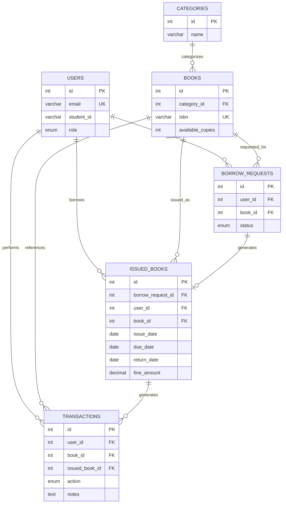
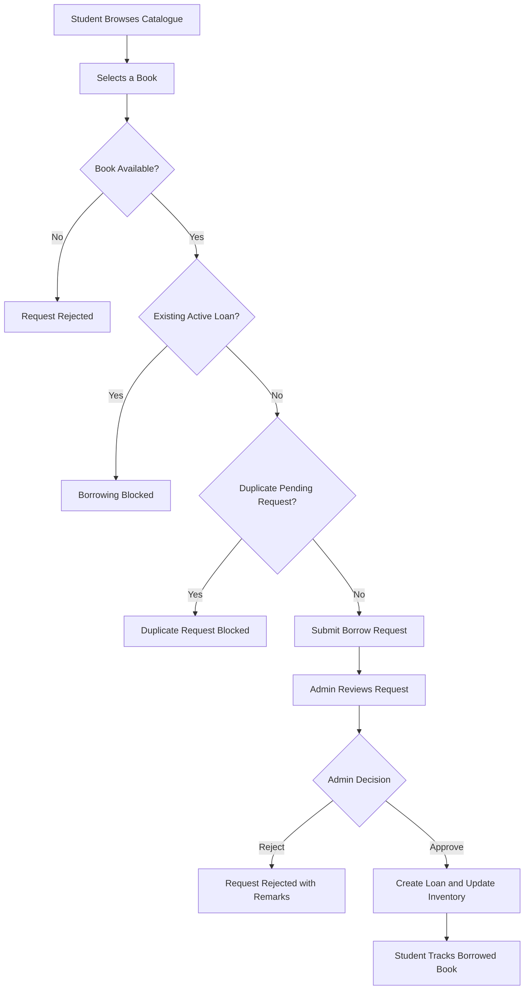

# The Archive | IIIT Kota Digital Library

> **Where Learning Goes Beyond Classrooms.**  
> *Your gateway to knowledge, discovery, and academic excellence.*

A centralized digital library management platform designed to modernize how students discover, access, borrow, and manage academic resources at **IIIT Kota**.

The Archive is a full-stack Library Management System developed to address the inefficiencies of traditional, manually managed library operations. It brings students, librarians, book inventory, borrowing requests, circulation records, and overdue tracking into one integrated platform.

Built using **HTML5, CSS3, Core PHP, and MySQL**, the application provides separate student and administrator interfaces, automated circulation workflows, real-time inventory updates, fine calculations, and secure role-based access control.

---

## Table of Contents

- [1. The Problem We're Solving](#1-the-problem-were-solving)
- [2. Project Overview](#2-project-overview)
- [3. Key Features](#3-key-features)
- [4. Technology Stack](#4-technology-stack)
- [5. System Architecture](#5-system-architecture)
- [6. Database Design](#6-database-design)
- [7. Core Application Workflows](#7-core-application-workflows)
- [8. Security and Engineering Practices](#8-security-and-engineering-practices)
- [9. Project Structure](#9-project-structure)
- [10. Installation and Setup](#10-installation-and-setup)
- [11. Demo Credentials](#11-demo-credentials)
- [12. Technical Highlights](#12-technical-highlights)
- [13. Future Scope](#13-future-scope)

---

## 1. The Problem We're Solving

### The Challenge

Traditional library management often involves disconnected processes and manual administrative work. Managing book inventories, tracking issued books, handling borrowing requests, and monitoring overdue returns can become increasingly difficult as the number of students and resources grows.

Some of the key challenges include:

- **Fragmented Book Discovery:** Students may have to physically visit the library or depend on manual catalogues to find available books.
- **Manual Circulation Management:** Tracking issued books, due dates, and returns manually increases administrative effort.
- **Inventory Inconsistency:** Without centralized inventory tracking, maintaining accurate information about available and issued copies becomes difficult.
- **Lack of Borrowing Transparency:** Students may not know whether their borrowing requests have been approved or rejected.
- **Inefficient Overdue Tracking:** Identifying overdue books and calculating accumulated fines manually is time-consuming.
- **Limited Administrative Visibility:** Librarians need a centralized view of inventory, student activity, pending requests, and circulation records.

### The Solution: The Archive

The Archive addresses these challenges through a centralized, database-driven library management system.

Instead of treating book discovery, borrowing, issuing, and returning as separate activities, the platform connects them through a unified application.

It provides:

- A searchable digital catalogue for students.
- An online borrowing request and approval system.
- Centralized book inventory management.
- Automated tracking of issue dates and return deadlines.
- Overdue detection and fine calculation.
- Administrative dashboards for monitoring library operations.
- Transaction records for maintaining accountability.

**The primary objective is to reduce manual administrative work, improve inventory accuracy, and make library resources more accessible and manageable.**

---

## 2. Project Overview

The Archive follows a role-based architecture with two primary user types.

| User Role | Responsibilities |
|---|---|
| Administrator | Manages inventory, students, borrowing requests, book circulation, returns, fines, and transaction records. |
| Student | Explores the catalogue, submits borrowing requests, tracks issued books, views borrowing history, and manages their profile. |

### What Makes This Project Different?

Rather than building a basic CRUD-based library website, The Archive implements actual library management workflows and business rules.

For example:

- A student cannot request a book if no copies are available.
- Duplicate pending borrowing requests are prevented.
- Students cannot request books they already hold.
- Approving a request updates inventory and creates an active loan record.
- Returning a book updates its availability and calculates applicable fines.
- Administrative actions are recorded in a transaction history.

These rules make the application more than a digital catalogue: they form the foundation of a functional library circulation system.

---

## 3. Key Features

### A. Public Portal

- Modern landing page with IIIT Kota library branding.
- Dynamic library statistics and featured book collections.
- Academic category-based book discovery.
- Responsive interface using native CSS.
- Dedicated login and student registration pages.
- Client-side and server-side form validation.

### B. Administrator Dashboard

**1. Library Analytics**
- Total book volumes.
- Available book copies.
- Registered students.
- Currently issued books.
- Overdue books.
- Pending borrowing requests.
- Recent circulation activity.

**2. Inventory Management**
- Add, edit, view, and delete books.
- Search by title, author, and ISBN.
- Filter books by category.
- ISBN uniqueness validation.
- Manage total and available copy counts.
- Add book descriptions, syllabus summaries, and cover images.
- Prevent deletion of books with active loans or pending requests.

**3. Student Management**
- View registered student accounts.
- Access student IDs and contact information.
- Monitor active loans and pending requests.
- Suspend or reactivate borrowing privileges.

**4. Circulation Management**
- Review and approve/reject borrowing requests.
- Provide remarks when rejecting requests.
- Issue books directly from the administrative interface.
- Track active and returned loans.
- Process book returns and calculate fines.
- Monitor overdue books and defaulters.
- Maintain a permanent transaction history.

### C. Student Dashboard

**1. Personalized Dashboard**
- Active borrowing count.
- Pending borrowing requests.
- Completed returns.
- Overdue book count.
- Upcoming return deadlines.

**2. Digital Book Catalogue**
- Browse the complete book collection.
- Search by title, author, or ISBN.
- Filter by academic category.
- View real-time availability indicators.

**3. Book Details and Borrowing**
- View detailed book descriptions and syllabus information.
- Check available copies.
- Submit borrowing requests.
- Receive request status updates.

**4. My Books and Borrowing History**
- Track currently borrowed books.
- View issue dates and due dates.
- Monitor remaining borrowing days.
- Identify overdue books.
- View applicable fines.
- Access previous borrowing and return records.

**5. Profile Management**
- View personal and academic information.
- Update name and contact number.
- Change password with current-password verification.

---

## 4. Technology Stack

The project deliberately uses fundamental web technologies instead of relying on frameworks, keeping the implementation transparent and demonstrating an understanding of core web development concepts.

| Layer | Technology | Purpose |
|---|---|---|
| Frontend | HTML5 | Semantic page structure and forms |
| Styling | CSS3 | Responsive layouts, Grid, Flexbox, and UI design |
| Backend | Core PHP | Application logic, authentication, and request processing |
| Database | MySQL / MariaDB | Relational data storage and management |
| Database Interface | MySQLi | Prepared statements and database operations |
| Server | Apache | Local web server |
| Development Environment | XAMPP | Local PHP and MySQL environment |
| Version Control | Git & GitHub | Source code management |

**Design philosophy:**
- No Bootstrap or Tailwind dependencies.
- No external frontend frameworks.
- No unnecessary backend frameworks.
- Native CSS and PHP implementation.
- No external CDN or remote font dependencies.
- Inline SVG assets for interface icons.

---

## 5. System Architecture

The Archive follows a modular, server-rendered PHP architecture in which the frontend, application logic, authentication layer, and relational database work together.

### High-Level Architecture

```text
                 ┌─────────────────────────┐
                 │       USER LAYER        │
                 │                         │
                 │    Student / Admin      │
                 └────────────┬────────────┘
                              │
                              ▼
                 ┌─────────────────────────┐
                 │     PRESENTATION LAYER  │
                 │                         │
                 │       HTML5 + CSS3      │
                 │   Dashboards / Forms    │
                 │    Search / Catalogue   │
                 └────────────┬────────────┘
                              │
                              ▼
                 ┌─────────────────────────┐
                 │     APPLICATION LAYER  │
                 │                         │
                 │         Core PHP        │
                 │                         │
                 │  Authentication         │
                 │  Business Logic         │
                 │  Request Processing     │
                 │  Inventory Management   │
                 │  Fine Calculation       │
                 └────────────┬────────────┘
                              │
                              ▼
                 ┌─────────────────────────┐
                 │     ACCESS CONTROL      │
                 │                         │
                 │    Session Management   │
                 │    Role-Based Guards    │
                 └────────────┬────────────┘
                              │
                              ▼
                 ┌─────────────────────────┐
                 │      DATA ACCESS LAYER  │
                 │                         │
                 │     MySQLi / PHP        │
                 │   Prepared Statements  │
                 └────────────┬────────────┘
                              │
                              ▼
                 ┌─────────────────────────┐
                 │      DATABASE LAYER     │
                 │                         │
                 │         MySQL           │
                 │      6 Relational       │
                 │         Tables          │
                 └─────────────────────────┘
```

### Architecture Components

**1. Presentation Layer**

The presentation layer is responsible for displaying the application interface and collecting user input.

It includes:
- Public landing page.
- Student dashboard.
- Administrator dashboard.
- Book catalogue and details.
- Borrowing and return forms.
- Profile and authentication pages.

**2. Application Layer**

Core PHP handles the actual application logic, including:
- User registration and login.
- Book and inventory operations.
- Borrowing request processing.
- Request approval and rejection.
- Book issuing and returning.
- Fine calculation.
- Student account management.

**3. Authentication and Authorization Layer**

The authentication layer manages user sessions and ensures that users can access only the functionality permitted by their roles.

The `includes/auth.php` module provides role-based access guards such as `require_admin()` and `require_student()`.

**4. Data Access Layer**

MySQLi prepared statements are used to communicate with the database.

This separates SQL queries from user-supplied values and helps protect database operations against SQL injection.

**5. Database Layer**

MySQL stores user accounts, categories, book inventory, borrowing requests, active loans, and transaction records.

Foreign keys and relational constraints help maintain consistency between related records.

### Application Design Approach

The project uses a modular PHP structure with reusable configuration and include files rather than duplicating common functionality across pages.

For example:
- `config/database.php` centralizes database connectivity and helper functions.
- `includes/auth.php` manages access control.
- Shared header, footer, and sidebar components maintain consistent layouts.
- Separate `admin/` and `student/` modules organize role-specific functionality.

---

## 6. Database Design

The application uses a relational MySQL database named `library_management`, consisting of **six interconnected tables**.

The database is designed to maintain relationships between users, books, borrowing requests, issued copies, and transaction records.

### Database Entities

| Table | Purpose |
|---|---|
| `users` | Stores student and administrator accounts, credentials, roles, and profile information. |
| `categories` | Stores academic and general book categories. |
| `books` | Maintains book information, ISBN, category, and copy availability. |
| `borrow_requests` | Tracks student borrowing requests and their approval status. |
| `issued_books` | Maintains book circulation records, issue dates, due dates, returns, and fines. |
| `transactions` | Records important library operations and administrative activities. |

### Entity Relationship Diagram



### Important Database Design Decisions

**Primary Keys and Foreign Keys**

- Every major entity has a primary key.
- Foreign keys connect related entities.
- Relationships prevent records from becoming disconnected from their associated entities.

**Uniqueness Constraints**

- Email addresses are unique in the users table.
- ISBN values are unique in the books table.

**Referential Integrity**

Foreign key constraints maintain relationships between records and help prevent invalid references.

**Inventory Consistency**

The `books` table maintains total and available copy counts. These values are updated when books are issued and returned.

**Historical Record Keeping**

The `issued_books` and `transactions` tables maintain circulation and activity history instead of treating borrowing as a temporary operation.

---

## 7. Core Application Workflows

This section explains how the application's business logic works beyond basic CRUD operations.

### A. Book Borrowing Workflow



The workflow ensures that requests are validated before they reach the administrator.

### B. Book Issuing and Returning

When an administrator approves a borrowing request:

1. The system validates book availability.
2. The request status is updated.
3. An active loan record is created.
4. The available copy count is decremented.
5. The transaction is recorded.

When a book is returned:

1. The system identifies the associated loan.
2. The return date is recorded.
3. Overdue days are calculated.
4. The applicable fine is determined.
5. The loan status is updated.
6. Available inventory is incremented.
7. A return transaction is recorded.

### C. Fine Calculation Logic

The system calculates overdue fines based on the number of days a book remains overdue.

**Default borrowing policy:**
- Standard borrowing duration: 14 days.
- Default fine: ₹5 per overdue day.

The calculation follows:

\[
\text{Fine} =
\text{Overdue Days} \times ₹5
\]

If a book is returned before or on its due date, no overdue fine is applied.

The overdue calculation is handled through the `calculate_overdue_and_fine()` helper function in `config/database.php`.

### D. Inventory Management Logic

Inventory updates are performed whenever a book is issued or returned.

**On issuing:**

```sql
UPDATE books
SET available_copies = available_copies - 1
WHERE id = ? AND available_copies > 0;
```

**On returning:**

```sql
UPDATE books
SET available_copies = LEAST(total_copies, available_copies + 1)
WHERE id = ?;
```

These checks help prevent negative inventory and ensure available copies do not exceed the total copy count.

### E. Transaction Management

Critical circulation operations use MySQL transactions.

```php
$conn->begin_transaction();

try {
    // Execute related database operations.

    $conn->commit();

} catch (Exception $e) {

    $conn->rollback();

    throw $e;
}
```

This ensures that related database operations are committed together or rolled back when an operation fails, preventing partially completed circulation updates.

---

## 8. Security and Engineering Practices

Security and data integrity were considered throughout the development process.

| Security Practice | Implementation |
|---|---|
| Password Security | PHP `password_hash()` and `password_verify()` using bcrypt-compatible password hashing. |
| SQL Injection Prevention | MySQLi prepared statements and parameter binding. |
| XSS Prevention | Output escaping using `htmlspecialchars()`. |
| Session Security | PHP session management and `session_regenerate_id(true)`. |
| Role-Based Access Control | Separate administrator and student access guards. |
| Input Validation | Client-side and server-side validation. |
| Database Integrity | Primary keys, foreign keys, and unique constraints. |
| Transaction Safety | MySQL transaction handling with commit and rollback. |
| Inventory Validation | Conditional stock updates to prevent negative availability. |
| Administrative Accountability | Transaction history for important library operations. |

### A Closer Look at Security Implementation

**1. Password Hashing**

Passwords are not stored as plain text.

PHP's native password hashing functions are used:

```php
$hashedPassword = password_hash(
    $password,
    PASSWORD_DEFAULT
);
```

During authentication:

```php
password_verify(
    $password,
    $user['password']
);
```

**2. SQL Injection Prevention**

Database queries use prepared statements:

```php
$stmt = $conn->prepare(
    "SELECT * FROM users WHERE email = ?"
);

$stmt->bind_param("s", $email);
$stmt->execute();
```

**3. Cross-Site Scripting Prevention**

Dynamic output is escaped using the custom `e()` helper:

```php
htmlspecialchars(
    $value,
    ENT_QUOTES,
    'UTF-8'
);
```

**4. Session Protection**

After successful authentication, the session ID is regenerated to reduce the risk of session fixation.

User identification and role information are maintained through PHP sessions.

**5. Role-Based Authorization**

Protected pages use centralized authentication guards to prevent students from accessing administrator functionality and vice versa.

---

## 9. Project Structure

```text
libs/
│
├── assets/
│   ├── css/
│   │   └── style.css
│   └── images/
│       └── covers/
│
├── config/
│   └── database.php
│
├── includes/
│   ├── auth.php
│   ├── header.php
│   ├── footer.php
│   └── sidebar.php
│
├── admin/
│   ├── dashboard.php
│   ├── manage_books.php
│   ├── add_book.php
│   ├── edit_book.php
│   ├── delete_book.php
│   ├── manage_students.php
│   ├── borrow_requests.php
│   ├── issue_book.php
│   ├── issued_books.php
│   ├── return_book.php
│   ├── overdue_books.php
│   └── transactions.php
│
├── student/
│   ├── dashboard.php
│   ├── books.php
│   ├── book_details.php
│   ├── request_borrow.php
│   ├── my_books.php
│   ├── borrow_history.php
│   └── profile.php
│
├── index.php
├── login.php
├── register.php
├── logout.php
├── database.sql
└── README.md
```

### Code Organization

- **assets/** – Stylesheets and book cover assets.
- **config/** – Database connection, configuration constants, and reusable helper functions.
- **includes/** – Shared UI components and authentication/authorization logic.
- **admin/** – Administrator-specific application modules.
- **student/** – Student-specific application modules.
- **database.sql** – Database schema and pre-seeded evaluation data.

---

## 10. Installation and Setup

Follow these steps to run The Archive locally.

### Prerequisites

- XAMPP
- PHP
- MySQL or MariaDB
- Web browser

### Step 1: Clone the Repository

```bash
git clone https://github.com/apoorva-shree/The_Archive.git
```

Alternatively, download the repository as a ZIP file.

### Step 2: Move the Project to XAMPP

Place the project folder inside:

```text
C:\xampp\htdocs\libs
```

### Step 3: Start Apache and MySQL

1. Open XAMPP Control Panel.
2. Start Apache.
3. Start MySQL.
4. Ensure both services are running.

### Step 4: Create and Import the Database

1. Open `http://localhost/phpmyadmin`.
2. Create a database named:

```sql
library_management
```

3. Select the newly created database.
4. Navigate to the Import tab.
5. Select the project's `database.sql` file.
6. Click Import/Go.

The database schema and sample evaluation records will be created.

### Step 5: Configure Database Connection

Check the database configuration in:

```text
config/database.php
```

Ensure the hostname, database name, username, and password match your local MySQL configuration.

### Step 6: Launch the Application

Open:

```text
http://localhost/libs/
```

You can now explore the public portal and log in using the evaluation credentials below.

---

## 11. Demo Credentials

The database comes pre-seeded with sample users, categories, books, borrowing requests, active loans, overdue records, and transaction logs.

| Role | Email | Password | Student / Roll ID |
|---|---|---|---|
| Administrator | `admin@library.com` | `admin123` | `EMP-001` |
| Student 1 | `rahul.sharma@college.edu` | `student123` | `CS2024001` |
| Student 2 | `priya.patel@college.edu` | `student123` | `IT2024045` |
| Student 3 | `ananya.verma@college.edu` | `student123` | `EC2024018` |

**Sample evaluation scenarios:**
- Student 1: Overdue book (*Clean Code*) with an applicable fine.
- Student 2: Overdue book (*Advanced Mathematics*) with an applicable fine.
- Student 3: Active loan (*Algorithms*).

New students can also register through the public registration page.

> **Note:** These are demonstration credentials intended for local evaluation. Change them and configure appropriate deployment security before exposing the application publicly.

---

## 12. Technical Highlights

The following implementation decisions demonstrate the engineering considerations behind the project.

| Area | Technical Implementation |
|---|---|
| Application Architecture | Modular, server-rendered PHP architecture |
| User Management | Session-based authentication and role-based authorization |
| Database Design | Six relational MySQL tables |
| Query Handling | MySQLi prepared statements |
| Password Security | Native PHP password hashing |
| Inventory Management | Conditional SQL stock updates |
| Data Consistency | Database transactions and rollback |
| Business Logic | Borrowing validation, circulation management, and fine calculation |
| Auditability | Persistent transaction history |
| Frontend Design | Native HTML5 and responsive CSS3 |

### Project Focus

The project demonstrates practical implementation of:

- Full-stack web application development.
- Relational database design and relationships.
- Authentication and authorization.
- CRUD operations and data validation.
- Backend business logic.
- Database transaction management.
- Inventory and resource management.
- Responsive user interface development.

---

## 13. Future Scope

The current implementation provides the core functionality required for digital library operations. Some potential enhancements include:

- Email notifications for borrowing approvals and upcoming due dates.
- QR code or barcode-based book issuing and returns.
- Advanced analytics for identifying popular books and borrowing patterns.
- Book reservation queues for currently unavailable titles.
- Digital book resources and downloadable study materials.
- Deployment on a cloud-hosted server with production database configuration.
- Automated database backups and recovery mechanisms.

These enhancements could further improve accessibility, automation, and scalability.

---

## Developed For

**Web Development Lab Evaluation | IIIT Kota**

**Project:** The Archive – Digital Library Management System

**Repository:** [GitHub – The Archive](https://github.com/apoorva-shree/The_Archive)

*Designed to make academic resources more accessible, library operations more efficient, and knowledge easier to discover.*

---

**The Archive — Where Learning Goes Beyond Classrooms.**
